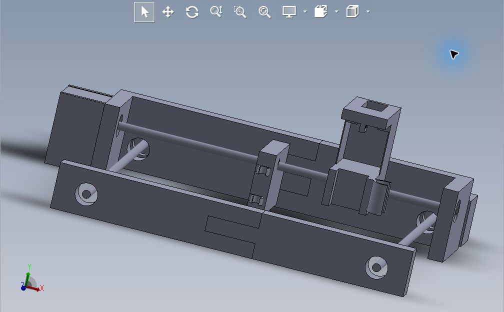

# Mathbot

Robot cartesiano en desarrollo para dibujar con lápiz o lapicero y, mediante un segundo cabezal, detectar y levantar objetos ferrosos. El proyecto combina diseño mecánico en SolidWorks, movimiento en los ejes X e Y y un mecanismo de elevación en Z.

**Estado:** en desarrollo. Esta entrega del repositorio contiene el diseño CAD; el firmware, el esquema eléctrico y las pruebas del robot físico no están incluidos.



La imagen es una captura del ensamblaje incluido, abierto en eDrawings. Representa el modelo CAD guardado, no una fotografía del prototipo físico.

## Movimiento

| Eje | Accionamiento descrito | Función |
| --- | --- | --- |
| Y | Dos motores con husillo | Desplazar el conjunto en el eje Y |
| X | Un motor con husillo | Desplazar el cabezal en el eje X |
| Z | Un motor para el mecanismo de polea | Elevar y bajar el objeto sujeto al electroimán |

La arquitectura contempla cuatro motores en total: tres con husillo para X/Y y uno para la elevación en Z. Los tres husillos utilizados tienen una longitud de **35 cm** cada uno.

## Cabezales

### Dibujo

El cabezal de dibujo permite insertar un lápiz o lapicero para trazar sobre una superficie mediante el desplazamiento del robot.

### Sensor y elevación

El segundo cabezal tiene un alojamiento para un **sensor de proximidad inductivo LJ18A3-8-Z/BX, NPN-NO**. En el centro se ubica el motor destinado al mecanismo de polea.

El funcionamiento previsto consiste en detectar un objeto ferroso, activar un electroimán para sujetarlo y levantarlo con la polea. La integración y la validación de esta secuencia siguen pendientes de documentar; los archivos CAD no demuestran por sí solos que el circuito y el control estén implementados.

## Componentes descritos

| Componente | Cantidad | Datos proporcionados para el proyecto |
| --- | --- | --- |
| Motores con husillo integrado | 3 | Dos para Y y uno para X; husillos de 350 mm |
| Motor de elevación | 1 | Acciona la polea del eje Z; modelo no especificado |
| Baleros o rodamientos | 6 | Diámetro interno de 8 mm y externo de 22 mm; ancho no especificado |
| Sensor inductivo | 1 | LJ18A3-8-Z/BX, NPN-NO; alojamiento previsto en el cabezal |
| Electroimán | 1 previsto | Destinado a sujetar el objeto; modelo y alimentación no especificados |
| Lápiz o lapicero | 1 durante el uso | Se inserta en el cabezal de dibujo |

[Referencia del tipo de motor compartida para el proyecto](https://www.amazon.com/dp/B0FNWZ67BZ). El enlace identifica la referencia comercial; las medidas de este Mathbot son las indicadas arriba. No se ha verificado la ficha del anuncio ni se presupone que todas sus variantes tengan el mismo husillo.

## Archivos CAD

La carpeta [`cad/`](cad/) conserva los nombres y el contenido de los archivos recibidos en `Mathbot - copia.zip`.

| Archivo | Descripción |
| --- | --- |
| `Ensamblaje2.SLDASM` | Ensamblaje principal |
| `Base x (derecha).SLDPRT` / `Base x (izquierda).SLDPRT` | Bases del eje X |
| `Base y (derecha).SLDPRT` / `Base y (izquierda).SLDPRT` | Bases del eje Y |
| `Soporte y (derecha).SLDPRT` / `Soporte y (izquierda).SLDPRT` | Soportes del eje Y |
| `base z dibujo.SLDPRT` | Cabezal para dibujo |
| `base z sensor y electroiman.SLDPRT` | Cabezal para sensor y electroimán |
| `Motor.SLDPRT` | Modelo CAD del motor |

## Abrir el diseño

1. Descarga o clona el repositorio completo.
2. Conserva juntos todos los archivos de `cad/`.
3. Abre `cad/Ensamblaje2.SLDASM` con SolidWorks para trabajar en el diseño, o con un visor compatible para consultar la geometría guardada.

```sh
git clone https://github.com/javieraguzman1204-cmd/mathbot.git
```

Se verificó la visualización del ensamblaje en eDrawings. No se ha comprobado su reconstrucción editable en SolidWorks, las tolerancias mecánicas ni el funcionamiento del hardware. Los archivos nativos se publican sin modificaciones; no se incluyen exportaciones STEP o STL en esta entrega.

## Trabajo pendiente de documentar

- Avance de fabricación, montaje y pruebas de movimiento y dibujo.
- Electrónica de control, alimentación, controladores de motores y conexiones del sensor y el electroimán.
- Firmware, calibración, sincronización de los motores de Y y secuencia de recogida y elevación.
- Planos acotados, materiales y resultados de pruebas de precisión y carga.

## Créditos

Proyecto compartido por Javier Guzmán para su portafolio. La relación de integrantes y sus aportaciones está pendiente de confirmar.
